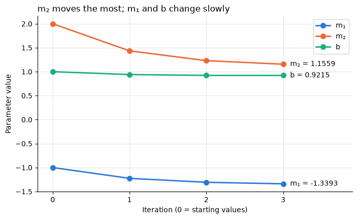
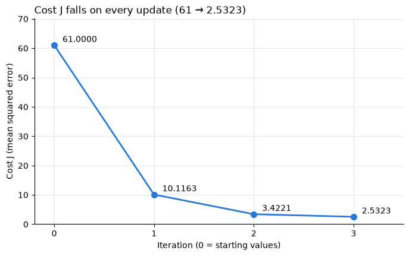

# Formative 3: Probability, Bayes and Gradient Descent

Group project covering four parts: the EM algorithm on a mixture of Gaussians, Bayes' theorem on IMDb reviews, gradient descent by hand, and gradient descent in Python.

## Team

| Member | Main responsibility |
| --- | --- |
| Person 1 | Part 1: Probability distributions and the EM algorithm |
| Naomi | Part 2: Bayesian probability on IMDb reviews |
| Byiringiro Saad | Parts 3 and 4: Gradient descent by hand and in code |

Every member completes at least one of the three manual gradient descent updates in Part 3, reviews another member's work, and presents.

## Repository

| File | Contents | Status |
| --- | --- | --- |
| `part1_em_algorithm.ipynb` | EM algorithm from scratch | In progress |
| `part2_bayes_imdb.ipynb` | Bayes' theorem on IMDb keywords | Done |
| `part3_manual_calculations.pdf` | Handwritten gradient descent updates | In progress |
| `part4_gradient_descent.ipynb` | Gradient descent in Python | Done |
| `images/` | Plots used in this README | |

## How to run

**In Google Colab:** open a notebook on GitHub and click its *Open in Colab* button.

**Locally:**

```bash
python3 -m venv .venv
source .venv/bin/activate
pip install numpy scipy matplotlib jupyter
jupyter notebook
```

Part 2 needs `IMDB Dataset.csv` (50,000 labelled reviews) in the repository folder; it is not committed because of its size. Part 4 needs no data file.

## Part 1: EM algorithm

Heights of parents and children are treated as an unlabelled mixture of two Gaussians, and the EM algorithm estimates each group's mean, variance and share of the data. The notebook prints the tracking table for the initial state and the first two iterations, classifies a test height with its posterior probabilities, and explains why splitting the data at the global mean is not enough.

*Results will be added when the notebook is committed.*

## Part 2: Bayesian probability

We compute **P(Positive | keyword)** for 4 positive and 4 negative keywords, using only Python's standard library. Each word counts once per review. The prior is P(Positive) = 0.5 (25,000 of 50,000 reviews).

| Keyword | Likelihood P(kw \| Pos) | Marginal P(kw) | Posterior P(Pos \| kw) |
| --- | --- | --- | --- |
| superb | 0.0410 | 0.0240 | 0.8557 |
| wonderful | 0.0902 | 0.0555 | 0.8120 |
| excellent | 0.1146 | 0.0710 | 0.8073 |
| brilliant | 0.0634 | 0.0417 | 0.7606 |
| boring | 0.0236 | 0.0610 | 0.1938 |
| awful | 0.0112 | 0.0575 | 0.0977 |
| worst | 0.0164 | 0.0886 | 0.0924 |
| waste | 0.0070 | 0.0507 | 0.0687 |

Every positive keyword lifts the chance of a positive review well above 0.5, and every negative keyword pushes it well below.

## Part 3: Gradient descent by hand

Model: y = m₁x₁ + m₂x₂ + b, written as ŷ = Xm + b, with X = [[1, 3], [4, 10]], y = [5, 6], starting m = [−1, 2] and b = [1, 1].

From the MSE cost J = (1/n)·Σ(ŷ − y)², the chain rule gives:

- ∂J/∂m = (2/n)·Xᵀ(ŷ − y)
- ∂J/∂b = (2/n)·Σ(ŷ − y)

Agreed conventions:

- Learning rate α = 0.005. The brief gives none; above about 0.0157 the cost grows instead of shrinking.
- b is one shared bias written once per data point, so both entries always stay equal.
- New m and b are rounded to 4 decimal places after each update.

| After | m₁ | m₂ | b | J | Done by |
| --- | --- | --- | --- | --- | --- |
| Start | −1.0000 | 2.0000 | 1.0000 | 61.0000 | |
| Update 1 | −1.2250 | 1.4350 | 0.9400 | 10.1163 | Byiringiro Saad |
| Update 2 | −1.3079 | 1.2302 | 0.9230 | 3.4221 | Person 1 |
| Update 3 | −1.3393 | 1.1559 | 0.9215 | 2.5323 | Naomi |

## Part 4: Gradient descent in code

The notebook repeats the Part 3 updates in NumPy with matrix multiplication and prints every step. `derivative(equation, params)` uses SciPy's `approx_fprime` to differentiate the cost equation, and it matches the derived formulas at every update. The printed numbers match the handwritten ones exactly.



m₂ moves the most because its feature x₂ has the largest values (3 and 10), giving it the largest gradient.



**The updates reduce the error every time:** J falls from 61 to 2.5323, 96% lower after three updates. The steps shrink as the cost flattens near its minimum. The final predictions are [3.0499, 7.1233] against targets [5, 6].

## Presentation plan

| Order | Topic | Presenter |
| --- | --- | --- |
| 1 | Part 1: EM algorithm, tracking table, live test height, global-mean question | Sylivie |
| 2 | Part 2: keyword choices and Bayes tables | Naomi |
| 3 | Parts 3 and 4: derivation, manual updates, code and plots | Byiringiro Saad |

The full presentation is 15 minutes, followed by questions for any member.
